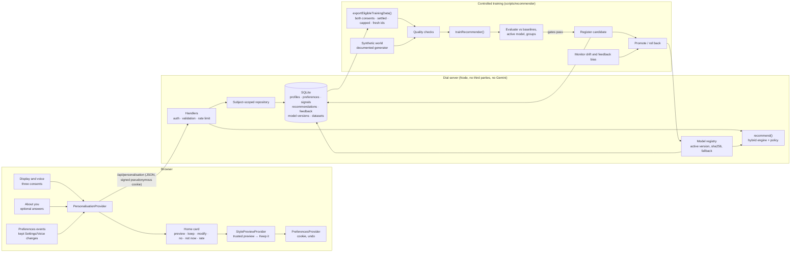

# Dial personalisation v2: architecture

Dial suggests a small, compatible set of display changes to each person. It learns which settings helped people
with similar, voluntarily given answers. Suggestions are previewed, kept, changed, turned down or undone only by the
person. This document covers the audit of v1, the choice of approach, the architecture and the data flow. Contracts and
ownership are in [CONTRACT.md](CONTRACT.md).

> **Evidence status.** Everything here is trained and evaluated on **synthetic data we generated**. It shows that the
> pipeline works and that the model recovers the structure we planted. It does **not** show that the suggestions help
> real people. That needs a consented pilot (see "What real evidence needs" below).

## 1. Audit of the existing ML system (v1, PR #10 + #12)

| Area | v1 | Gap against the v2 brief |
|---|---|---|
| Model | Random forest per target (30 trees, depth 5), 8 binary "would keep" targets | Independent per-setting predictions. No combinations, no ranking, no collaborative signal |
| Inputs | Display settings, "Make it yours" ticks, 6 signal counts | No profile (experience, interaction preferences). Very little to go on for a new person |
| Learning | Synthetic only, offline, once | No feedback loop, no versioning, no rollback, no monitoring |
| Storage | `localStorage` on one device | No database, nothing collective to learn from |
| Output | One suggestion, a probability, tree-interpreter reasons | No alternatives, no evidence level, no insufficient-data warnings |
| Privacy | Consent, on-device, deletion on opt-out | Good. Kept as the bar v2 must meet |
| Cost | 209 KB downloaded after consent, about 0.006 ms per inference | Fine. v2 moves inference to Dial's server: nothing is downloaded |

v1 stays in the repository as the **baseline** in the v2 evaluation (with its own tests). Its card and storage are
replaced by v2 in the app.

## 2. Choosing the approach

| Approach | Strengths | Weaknesses here | Verdict |
|---|---|---|---|
| Popularity | Trivial, robust | Same answer for everyone; "popular" isn't "suitable" | Baseline and prior only |
| Rules ("Make it yours") | Transparent, no data needed | Hand-written assumptions; can't learn | Kept as the fallback, and a baseline |
| Content-based (profile → item model) | Works for a brand-new person from answers alone; explainable per answer | Learns each item separately; ignores what similar people actually kept together | Component |
| User-based collaborative filtering (neighbours) | "People like you kept this": the product vision | Raw neighbours means storing individual rows; sparse for new people | Component, but over **aggregated clusters** (no individual rows in the model) |
| Item-based collaborative filtering | Uses a person's own history ("kept A, so B") | Needs history; nothing for new people | Component, for warm people |
| Matrix factorisation with side features (LightFM-style hybrid) | Learns shared structure between items and profiles; cold start through features | Needs tuning; less transparent | Component |
| Contextual bandit | Learns online, handles exploration | Needs live traffic and logged propensities; retraining on every interaction is ruled out by the brief | **Not now.** v2 logs every shown item's score and rank, so off-policy evaluation and a bandit become possible later |
| Deep models | Expressive | Far more data than we have; heavy; opaque | Rejected |

**Chosen: a hybrid.** Content-based, aggregated collaborative and factorisation scores are combined by a small logistic
stacker fitted on a held-out validation set. That makes the output a calibrated probability. A policy layer then
enforces eligibility, explicit-settings-win, cooldowns and fatigue, and picks the best compatible combination plus
alternatives. Learned parts and product rules are separate files.

## 3. Architecture

The **feedback loop** (brief Part 8):
1. The person answers About you or changes a setting.
2. The engine evaluates their profile (`POST /recommendations`).
3. It returns a ranked configuration and alternatives.
4. The person previews it.
5. They keep, modify, reject, put off or undo it.
6. Feedback is stored with the point-in-time input.
7. Eligible records (both consents, settled, capped) are exported without stored ids.
8. The export is validated and combined with the synthetic base.
9. A candidate version is trained and evaluated against gates.
10. It is promoted (or rolled back) by a person running a script, never automatically on each interaction.

## 4. Where the brief's requirements live

| Requirement | Where |
|---|---|
| Profile schema, optional, demographics separate | `lib/recommender/profile.ts` |
| Configuration space, compatibility, explicit wins | `lib/recommender/catalog.ts`, engine policy layer |
| Hybrid model, confidence, explanations, evidence, warnings | `lib/recommender/engine/` |
| Database, migrations, access control, retention, deletion | `lib/server/`, [DATABASE.md](DATABASE.md) |
| APIs | `app/api/personalisation/`, [API.md](API.md) |
| Synthetic data, training, evaluation, fairness, versioning | `lib/recommender/synthetic.ts`, `lib/recommender/evaluation/`, `scripts/recommender/`, [EVALUATION.md](EVALUATION.md), [SYNTHETIC-DATA.md](SYNTHETIC-DATA.md), [FAIRNESS.md](FAIRNESS.md), [PIPELINE.md](PIPELINE.md) |
| App integration (consent, card, About you) | `lib/personalisation/{provider,client,controller}`, `components/personalise/` |

## 5. What real evidence needs

Synthetic results can't show that suggestions help people. Before any claim of benefit, Dial needs:
- a consented pilot with real users, with usability outcomes measured directly: task success and time on a fixed set of money tasks, plus the "Did that make Dial easier to use?" rating;
- comparison against the rules fallback;
- the fairness checks in [FAIRNESS.md](FAIRNESS.md) run on that data;
- and enough consented feedback to pass the pipeline's minimum sample thresholds.
