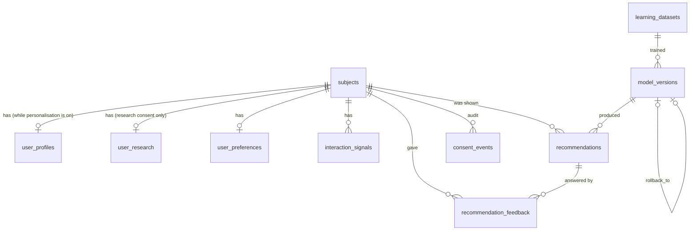

# Dial personalisation v2: database

Owner: WS4 (backend). Code: `lib/server/db` (connection, migrations) and `lib/server/personalisation` (all SQL).
Decisions and the consent model are in [CONTRACT.md](./CONTRACT.md). The HTTP API is in [API.md](./API.md).

## In short

- One SQLite file, opened with Node's built-in `node:sqlite`. No npm dependency, no service, no cost.
- A person is a random, pseudonymous **subject** id. It is not linked to the card account or to anything financial.
- Nothing is stored before the person turns personalisation on. Turning it off deletes every row about them.
- Every personal table hangs off `subjects` with `ON DELETE CASCADE`, so one `DELETE` erases a person completely.
- SQLite has no row-level security, so access control lives in one place: the per-subject repository.
- Never stored: money, transactions, audio, transcripts, questions to Dial, anything inferred.

## Why SQLite

- It is real SQL: foreign keys, CHECK constraints, partial unique indexes, transactions, `STRICT` tables.
- It ships with Node 24 (`node:sqlite`, no flag), so the hackathon app needs nothing new to install or pay for.
- The data is small: a few rows per person per day.
- Limitation: it needs a persistent disk (a VM, a container with a volume, or `next start` on a laptop).
  A serverless host with an ephemeral disk needs a hosted database instead. See "Moving to Postgres".

## Where it lives

| Setting | Default | Notes |
|---|---|---|
| `PERSONALISATION_DB_PATH` | `<working directory>/.data/personalisation.sqlite` | The directory is created on first use. `:memory:` works (tests use it). |
| `PERSONALISATION_SECRET` | none | HMAC key for the session cookie. At least 32 characters. If it is missing or too short, a random secret is generated once into `<database directory>/personalisation-secret` (mode 0600) and reused. |

`.data/` must be git-ignored (the integration lead owns `.gitignore`).

The app opens one connection per server process, lazily, on the first API call (`getAppDatabase()`).
Pragmas: `foreign_keys = ON`, `busy_timeout = 5000`, and for files `journal_mode = WAL` and `synchronous = NORMAL`.
If the database can't be opened (read-only disk, old Node, a changed migration), the API answers 503, logs once,
retries at most once a minute, and the rest of Dial carries on without suggestions.

## Entity relationships

Personal tables (left of `subjects`) cascade on delete. `learning_datasets` and `model_versions` hold no personal data.

## Conventions

- `snake_case`. Every table is `STRICT` (SQLite enforces the column types).
- Times are epoch milliseconds in `INTEGER` columns.
- JSON lives in `TEXT` with `CHECK (json_valid(x) AND json_type(x) = 'object' | 'array')`.
- Every enum has a `CHECK (x IN (...))`. A test checks each list still matches its TypeScript constant.
- Hashes are 64 lowercase hex characters, checked with `NOT GLOB '*[^0-9a-f]*'`.

## Tables

### `schema_migrations`

| Column | Type | Constraints |
|---|---|---|
| `version` | INTEGER | PK, `>= 1` |
| `name` | TEXT | NOT NULL |
| `checksum` | TEXT | NOT NULL, sha256 of the migration SQL (line endings normalised), 64 chars |
| `applied_at` | INTEGER | NOT NULL |

### `subjects`: one pseudonymous person

| Column | Type | Constraints |
|---|---|---|
| `id` | TEXT | PK. 32 lowercase hex characters (128 random bits) |
| `created_at` | INTEGER | NOT NULL |
| `last_seen_at` | INTEGER | NOT NULL, `>= created_at`. Updated at most once a day |

Index: `subjects_last_seen (last_seen_at)` for the inactivity purge.

### `user_profiles`: "About you" answers and consent (UserProfile)

Exists only while personalisation is on: withdrawing it deletes the subject and so this row.

| Column | Type | Constraints |
|---|---|---|
| `subject_id` | TEXT | PK, FK → `subjects(id)` ON DELETE CASCADE |
| `answers` | TEXT | JSON object, NOT NULL, default `{}`. Validated against `lib/recommender/profile.ts` before writing |
| `profile_version` | INTEGER | NOT NULL, `>= 1` (`PROFILE_VERSION`) |
| `personalisation_consent` | TEXT | NOT NULL, always `'granted'` (CHECK) |
| `personalisation_consent_at` | INTEGER | NOT NULL |
| `collaborative_consent` | TEXT | `'unset' \| 'granted' \| 'declined'`, default `'unset'` |
| `collaborative_consent_at` | INTEGER | NULL exactly when `'unset'` (CHECK) |
| `research_consent` | TEXT | `'unset' \| 'granted' \| 'declined'`, default `'unset'` |
| `research_consent_at` | INTEGER | NULL exactly when `'unset'` (CHECK) |
| `created_at`, `updated_at` | INTEGER | NOT NULL |

Index: `user_profiles_collaborative (collaborative_consent)` for the training export.

### `user_research`: optional age band (separate consent)

Never read by the recommender or the training export. Used only for aggregate fairness checks.

| Column | Type | Constraints |
|---|---|---|
| `subject_id` | TEXT | PK, FK → `subjects(id)` ON DELETE CASCADE |
| `age_band` | TEXT | NOT NULL, `'18-24' \| '25-34' \| '35-49' \| '50-64' \| '65+'` |
| `updated_at` | INTEGER | NOT NULL |

Withdrawing research consent deletes this row in the same transaction.

### `user_preferences`: latest settings snapshot (UserPreferences)

| Column | Type | Constraints |
|---|---|---|
| `subject_id` | TEXT | PK, FK → `subjects(id)` ON DELETE CASCADE |
| `preferences` | TEXT | JSON object. Passed through `sanitize()` from `lib/preferences/schema.ts` |
| `view` | TEXT | `'simple' \| 'complex'` |
| `explicit_dimensions` | TEXT | JSON array of dimensions, default `[]`. **Sticky** (see below) |
| `updated_at` | INTEGER | NOT NULL |

Sticky explicit dimensions: each `POST /recommendations` stores the union of what was stored, what the client sent,
and every dimension not at its default (`nonDefaultDimensions`). A dimension stops being explicit only when the
subject is deleted. Once someone sets something themselves, Dial never suggests a change to it, even after a reload.

### `interaction_signals` (InteractionSignals)

| Column | Type | Constraints |
|---|---|---|
| `id` | INTEGER | PK |
| `subject_id` | TEXT | NOT NULL, FK → `subjects(id)` ON DELETE CASCADE |
| `signal` | TEXT | one of `SIGNAL_IDS` (`textLarger`, `textSmaller`, `lessOnScreen`, `moreDetail`, `moreVisual`, `voiceSessions`, `shorterAnswers`, `undoneChanges`) |
| `source` | TEXT | `'settings' \| 'voice' \| 'style' \| 'onboarding' \| 'dial'` |
| `created_at` | INTEGER | NOT NULL |

Indexes: `interaction_signals_subject_time (subject_id, created_at)`, `interaction_signals_time (created_at)`.
At most 20 per request and 200 per subject per rolling 24 hours are stored. The engine sees counts over the last
180 days, each capped at `SIGNAL_CAP` (10).

### `learning_datasets` (LearningDatasetMetadata)

Metadata only. A dataset is never stored as a copy.

| Column | Type | Constraints |
|---|---|---|
| `version` | TEXT | PK, 1 to 128 characters |
| `source_from`, `source_to` | TEXT | ISO times of the oldest and newest real record, or NULL |
| `eligible_records`, `eligible_subjects`, `synthetic_records` | INTEGER | NOT NULL, `>= 0` |
| `excluded` | TEXT | JSON object: exclusion counts by reason |
| `criteria` | TEXT | JSON object: eligibility criteria, or the generator settings |
| `preprocessing_version` | TEXT | NOT NULL, non-empty |
| `content_sha256` | TEXT | NOT NULL, 64 hex |
| `created_at` | INTEGER | NOT NULL |

### `model_versions` (ModelVersions)

| Column | Type | Constraints |
|---|---|---|
| `version` | TEXT | PK, 1 to 128 characters (`ModelHeader.version`) |
| `dataset_version` | TEXT | NOT NULL, FK → `learning_datasets(version)` |
| `algorithm` | TEXT | NOT NULL, non-empty |
| `trained_on` | TEXT | `'synthetic' \| 'synthetic+real'` |
| `config`, `metrics` | TEXT | JSON objects |
| `artifact_path` | TEXT | NULL for the model bundled with the app; else a JSON file (absolute, or relative to the working directory) |
| `artifact_sha256` | TEXT | NOT NULL, 64 hex. Over the file bytes, or over `JSON.stringify(model)` for the bundled model |
| `size_bytes` | INTEGER | NOT NULL, `>= 0` |
| `status` | TEXT | `'candidate' \| 'active' \| 'retired' \| 'rejected'`, default `'candidate'` |
| `created_at` | INTEGER | NOT NULL |
| `activated_at`, `retired_at` | INTEGER | `activated_at` NOT NULL when active (CHECK) |
| `rollback_to` | TEXT | FK → `model_versions(version)` ON DELETE SET NULL, never itself (CHECK) |
| `notes` | TEXT | |

Indexes: `model_versions_one_active` (partial unique index on `status` `WHERE status = 'active'`, so at most one
active model), `model_versions_dataset (dataset_version)`.

### `recommendations` (Recommendations)

| Column | Type | Constraints |
|---|---|---|
| `id` | TEXT | PK, random UUID (36 characters) |
| `subject_id` | TEXT | NOT NULL, FK → `subjects(id)` ON DELETE CASCADE |
| `model_version` | TEXT | NOT NULL, FK → `model_versions(version)` |
| `configuration` | TEXT | JSON object (the `Configuration` shown) |
| `alternatives` | TEXT | JSON array of `Configuration` |
| `scores` | TEXT | JSON array: every ranked `ItemScore`, kept for off-policy evaluation |
| `confidence` | REAL | NOT NULL, 0 to 1 |
| `evidence_level` | TEXT | `'strong' \| 'moderate' \| 'limited' \| 'insufficient'` |
| `rationale` | TEXT | JSON object: `{ summary, reasons }` |
| `warnings` | TEXT | JSON array |
| `input_snapshot` | TEXT | JSON object: `{ answers, preferences, view, explicit, signals }` at that moment. Never research data |
| `status` | TEXT | `'shown' \| 'accepted' \| 'modified' \| 'rejected' \| 'dismissed' \| 'reverted'`, default `'shown'` |
| `created_at`, `updated_at` | INTEGER | NOT NULL |

`UNIQUE (id, subject_id)` lets feedback reference the pair. Indexes: `recommendations_subject_time
(subject_id, created_at)`, `recommendations_time (created_at)`, `recommendations_model (model_version)`.

An open (`shown`) recommendation with the same model version, configuration and alternatives from the last 24 hours
is re-used rather than stored again.

### `recommendation_feedback` (RecommendationFeedback)

| Column | Type | Constraints |
|---|---|---|
| `id` | INTEGER | PK |
| `recommendation_id` | TEXT | NOT NULL |
| `subject_id` | TEXT | NOT NULL, FK → `subjects(id)` ON DELETE CASCADE |
| `outcome` | TEXT | `'accepted' \| 'modified' \| 'rejected' \| 'dismissed' \| 'reverted'` |
| `items` | TEXT | JSON array of item ids: kept (accepted, modified), turned down (rejected, dismissed) or undone (reverted) |
| `via` | TEXT | NULL or `'card' \| 'undo' \| 'settings' \| 'reset'` |
| `satisfaction` | INTEGER | NULL or `-1 \| 0 \| 1`, only on an accepted or modified row (CHECK) |
| `created_at` | INTEGER | NOT NULL |

`FOREIGN KEY (recommendation_id, subject_id) REFERENCES recommendations (id, subject_id) ON DELETE CASCADE`: the
database itself refuses feedback from anyone but the person the suggestion was made for.
Indexes: `(recommendation_id, created_at)`, `(subject_id, created_at)`, `(created_at)`.

Status changes: `shown` → `accepted | modified | rejected | dismissed`; `accepted | modified | reverted` →
`reverted` (only items still kept). Anything else is a 409. A rating sets `satisfaction` on the accepted or modified
row; a new rating replaces the old one.

### `consent_events`: audit of consent changes

| Column | Type | Constraints |
|---|---|---|
| `id` | INTEGER | PK |
| `subject_id` | TEXT | NOT NULL, FK → `subjects(id)` ON DELETE CASCADE |
| `kind` | TEXT | `'personalisation' \| 'collaborative' \| 'research'` |
| `granted` | INTEGER | 0 or 1 |
| `policy_version` | TEXT | NOT NULL (`CONSENT_POLICY_VERSION`) |
| `created_at` | INTEGER | NOT NULL |

Index: `(subject_id, created_at)`. The audit is erased with the subject: once someone asks to be forgotten, nothing
about them remains, including the record that they once agreed.

## Access control

SQLite has no row-level security, so the code provides it.

1. **One door.** Only `lib/server/personalisation` contains SQL. Route files call handlers; handlers call repositories.
2. **Bound repositories.** `forSubject(db, subjectId)` returns functions that all use `WHERE subject_id = ?` with the
   bound id, including lookups by recommendation id (`WHERE id = ? AND subject_id = ?`).
3. **The id comes from the cookie only.** No endpoint accepts a subject id. The cookie is HMAC-signed, so it can't be
   forged or swapped, and a signature for a deleted subject counts as no session.
4. **No probing.** Another person's recommendation id gives 404, the same as an id that doesn't exist.
5. **Belt and braces.** The composite foreign key on feedback stops a cross-subject row even if code were wrong.
6. **Training and monitoring** never return stored subject ids. The export gives each person a fresh random id per
   export; monitoring returns counts only.

Tests in `lib/server/personalisation/*.test.ts` prove each of these, including end-to-end HTTP requests from two
"browsers".

## Consent, deletion and the person's rights

| Action | Effect |
|---|---|
| Turn personalisation on | Creates `subjects` + `user_profiles` + a `consent_events` row, in one transaction. Sets the cookie. |
| Turn collaborative learning off | Updates the profile. The person is left out of every later training export at once. |
| Turn research off | Updates the profile and deletes `user_research` in the same transaction. |
| Turn personalisation off, or `DELETE /api/personalisation` | `DELETE FROM subjects WHERE id = ?`. Cascades remove every other row. Clears the cookie. |
| `GET /api/personalisation/export` | Every row about the person, as JSON. |

Already-trained models keep only aggregate parameters, never rows, so deletion needs no retraining.

## Retention

`purgeExpired(db, now)` runs at most hourly on API use, and at the start of every training run.

| Data | Kept for |
|---|---|
| `interaction_signals` | 180 days |
| `recommendations` (and their feedback) | 365 days |
| `recommendation_feedback` | 365 days |
| A subject not seen for 400 days | deleted with everything about them |

## Training export (summary)

`exportEligibleTrainingData(db, criteria, now)` in `pipeline-store.ts` implements CONTRACT.md §8:

- Only subjects whose profile has personalisation **and** collaborative consent granted at export time.
  Everyone else is counted (`no_consent`) without reading their data.
- A record is a recommendation with an answer. Its answer must be at least `minAgeHours` old (the undo window) and at
  most `maxAgeDays` old.
- Labels per item: kept and not undone (via undo or settings) and not rated -1 → 1. Turned down, a main-configuration
  item left out of a modified suggestion, undone (not by a reset), or rated -1 → 0. No label: "Not now", alternative
  items not kept, and items undone by a reset.
- Input: the stored `input_snapshot` plus history built only from that person's feedback before the suggestion.
- A fresh random id per person per export, at most `maxExamplesPerSubject` examples each (the newest), duplicates
  dropped. Every exclusion is counted by reason (`EXCLUSION_REASONS` documents each reason and its unit).
- Read-only. Research data is never read.

## Migrations

- Each migration is a TypeScript module exporting `{ version, name, sql }` (`lib/server/db/migrations`), so nothing
  reads files at runtime and the bundler is happy.
- `openDatabase()` applies pending migrations in order, each in its own transaction, and records a sha256 checksum.
- It refuses to start if an applied migration's SQL changed, or if the database has a migration the code doesn't
  know. Never edit an applied migration: add the next one.
- Enum lists in the SQL are literals (a migration is history). When a TypeScript enum changes (say a new signal),
  `schema.test.ts` fails until a new migration updates the CHECK (SQLite needs a table rebuild for that).

## Operations

- **Backups.** WAL mode keeps recent writes in `personalisation.sqlite-wal`. Either stop the server and copy the
  `.sqlite` file, or take a live copy with `sqlite3 .data/personalisation.sqlite ".backup backup.sqlite"`
  (or `node:sqlite`'s `backup()`). Treat backups as personal data, and delete them on the same 400-day schedule:
  a backup restores people who asked to be deleted.
- **Secret.** Set `PERSONALISATION_SECRET` (32+ random characters) in production. Changing it signs everyone out:
  their old rows can no longer be reached and are purged after 400 days.
- **Size.** Rough upper bound per active person per year: under 1 MB (mostly the `scores` JSON).
- **Training scripts.** `lib/server/personalisation/pipeline-store.ts` loads under plain Node 24 with the existing
  resolver hook: `node --no-warnings --import ./scripts/personalisation/ts-resolve.mjs <script>.ts`. Call
  `purgeExpired()` first, then `exportEligibleTrainingData()`.
- **Moving the file.** Set `PERSONALISATION_DB_PATH`. The secret file follows the database directory unless
  `PERSONALISATION_SECRET` is set.

## Moving to Postgres with row-level security

Needed for a serverless host. It is a new service, and possibly a cost, so it needs the product owner's approval.

1. Port the migration SQL: `TEXT` JSON → `jsonb`, epoch ms → `bigint` (or `timestamptz`), `STRICT` dropped, the
   partial unique index and CHECKs carry over unchanged.
2. Swap `lib/server/db/sqlite.ts` and `query.ts` for a `pg` pool. Repository functions become async; their SQL is
   already plain and parameterised. `transaction()` becomes `BEGIN ... COMMIT` on one pooled client.
3. Add RLS as a second line of defence: `ALTER TABLE ... ENABLE ROW LEVEL SECURITY` and
   `CREATE POLICY own_rows ON <table> USING (subject_id = current_setting('app.subject_id'))`, with the repository
   running `SET LOCAL app.subject_id = $1` at the start of each transaction. Run the training export under a
   separate role that can only read consenting subjects (a policy joining `user_profiles`).
4. Keep `forSubject()` as the only door: RLS backs it up rather than replacing it.

## Known limitations

- Single writer process per file (SQLite). Fine for one server; not for many instances behind a load balancer.
- Rate limits are in memory, per process, keyed by the first `X-Forwarded-For` address before a session exists,
  which a client can vary when no trusted proxy sets it.
- Monitoring returns counts; very small counts could still say something about a small group. Report them only
  above a minimum cell size.
- Times come from the server clock; a clock jump backwards can delay retention or the undo window.
